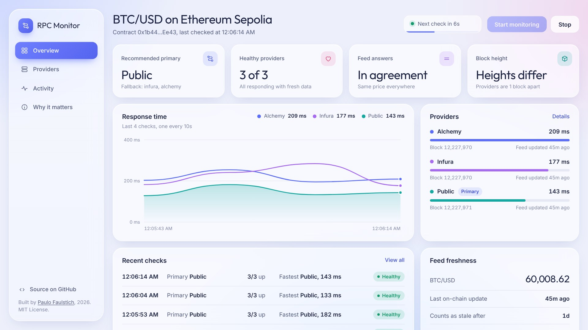

# RPC Reliability Monitor

**A Web3 product can serve stale or inconsistent on-chain data long before its RPC provider
looks "down".** This project reads one Chainlink Data Feed through several RPC providers at
once, compares what each returns, and recommends a primary provider with ranked fallbacks.

> **Status:** working prototype on Ethereum Sepolia (testnet). A self-directed study project,
> not production software. Built to understand RPC infrastructure from the product side:
> what to measure, what "healthy" means, and when to route around a provider.



[Watch the 35-second demo](https://github.com/user-attachments/assets/0fbba130-6965-4788-8958-bea28306e2d1)

## The problem

Teams usually treat RPC as a commodity API: pick a provider, add the URL, move on. The failure
that hurts is rarely a clean outage. It is a provider that still answers but is a few blocks
behind, slow at the tail, or serving a price feed that has not updated. A liveness check
passes, and the product makes decisions on old data.

Seeing that requires comparison. One provider alone cannot tell you it is behind.

## What it does

Each cycle sends the same three calls to every provider (`eth_chainId`, `eth_blockNumber`, and
`latestRoundData()` on the feed contract) and derives:

| Signal | Question it answers |
|---|---|
| Latency | Is this provider slow right now? |
| Block height vs the others | Is it behind the chain tip? |
| Feed answer vs the others | Do providers agree on the data? |
| Feed age vs a threshold | Is the data fresh, even if the provider is "up"? |
| Recommended primary + fallbacks | Who should we route to, and who is next? |

The recommendation rule is deliberately simple: the fastest provider among those that are
healthy **and** not stale. Freshness gates health, so a fast provider serving old data is never
picked.

It uses raw JSON-RPC with zero dependencies, so the infrastructure behavior stays visible
instead of hidden behind an SDK.

## What it showed

Observed on 30 June 2026 with Alchemy, Infura and a public node, reading BTC/USD on Sepolia.
These are the cycles captured in the demo recording and in
[`prototype/docs/sample-output.md`](prototype/docs/sample-output.md):

| Cycle | Alchemy | Infura | Public node | Block agreement | Answer agreement |
|---|---|---|---|---|---|
| 1 | 256ms | not configured | 250ms | yes | yes |
| 2 | 248ms | 251ms | 226ms | yes | yes |
| 3 | 191ms | 159ms | 124ms | yes | yes |

- The free public endpoint was the fastest in all three cycles, ahead of every keyed provider
  configured at the time.
- All providers agreed on block height and feed answer in every cycle.
- Latency moved a lot between consecutive cycles (Infura went from 251ms to 159ms in about
  ten seconds), which is why a single reading is a poor basis for routing.

Three cycles are an observation, not a benchmark. `npm run benchmark` takes a proper sample
(30 cycles by default) and writes p50/p95 latency, success rate, block lag, stale cycles and
routing flap per provider to `prototype/docs/benchmark-results.md`.

## Product thinking behind it

The prototype came first. The product artifacts were then written from what it demonstrated:
**prototype → evidence → spec**.

| Document | What it answers |
|---|---|
| [Problem frame](pm-operating-model/01-problem-frame.md) | What is broken, who it hurts, why it matters |
| [Hypotheses](pm-operating-model/02-hypotheses.md) | What we believe and how the prototype tests it |
| [PRD](pm-operating-model/03-prd.md) | Scope, requirements, trade-offs |
| [Epics & user stories](pm-operating-model/04-epics-user-stories.md) | The work as deliverable slices |
| [Metrics](pm-operating-model/05-metrics.md) | How reliability is measured and what success looks like |
| [Roadmap & prioritization](pm-operating-model/06-roadmap-prioritization.md) | Sequence and rationale |
| [Tech spec](pm-operating-model/07-tech-spec.md) | How it works and the path to production |

## Quick start

Requires Node.js 18 or later. No install step.

```bash
cd prototype
cp .env.example .env   # add your RPC provider URLs
npm run dashboard      # live dashboard at http://localhost:4173
npm run monitor        # one-off CLI check
npm run benchmark      # sampled run, writes docs/benchmark-results.md
```

It runs with only the default public endpoint, but the point is comparing several. See
[`prototype/README.md`](prototype/README.md) for configuration and details.

## Limitations

- Read path only. Transaction submission and confirmation are not measured.
- One vantage point. Latency includes the network path from the machine running it.
- Testnet. Sepolia traffic and provider behavior differ from mainnet.
- Any difference in block height is flagged, including the one-block lag that is normal
  propagation. A production version needs a tolerance.
- No alerting or persistence. Results live in memory and in the benchmark report.

---

Built by [Paulo Faulstich](https://github.com/paulo-faulstich) · 2026 · [MIT License](LICENSE)
